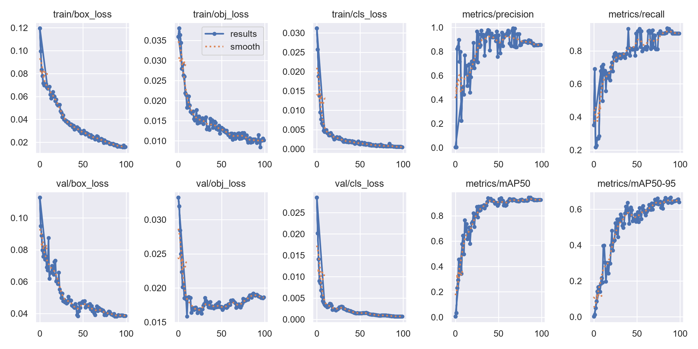
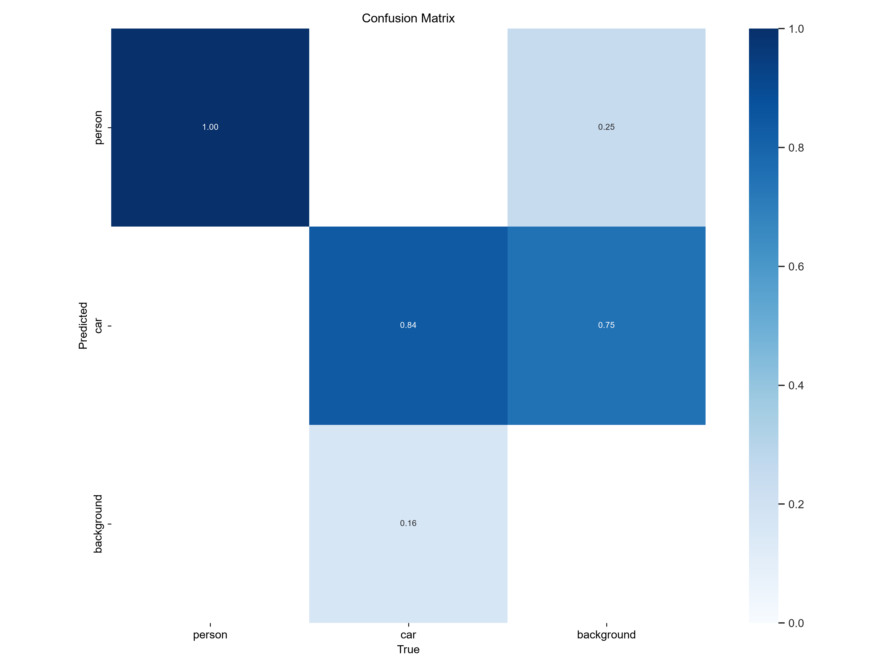
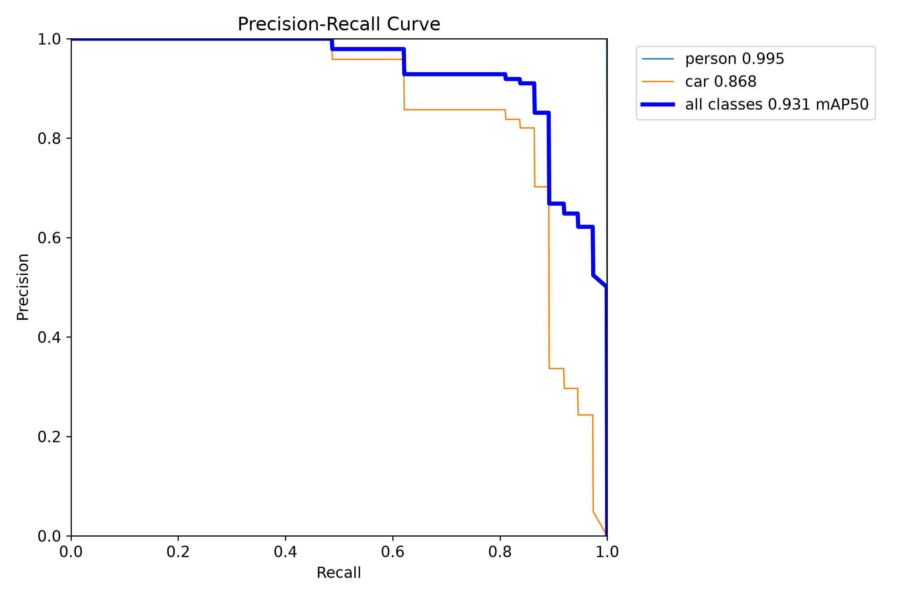
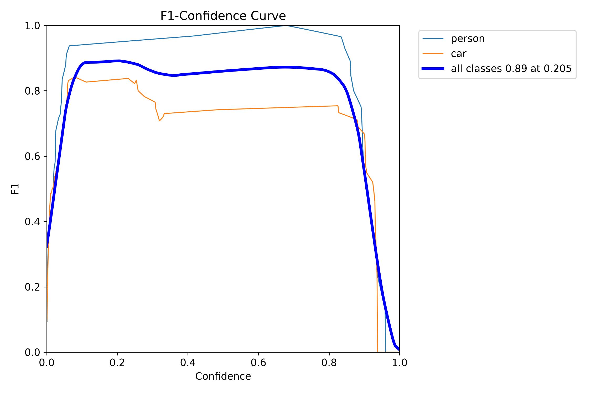
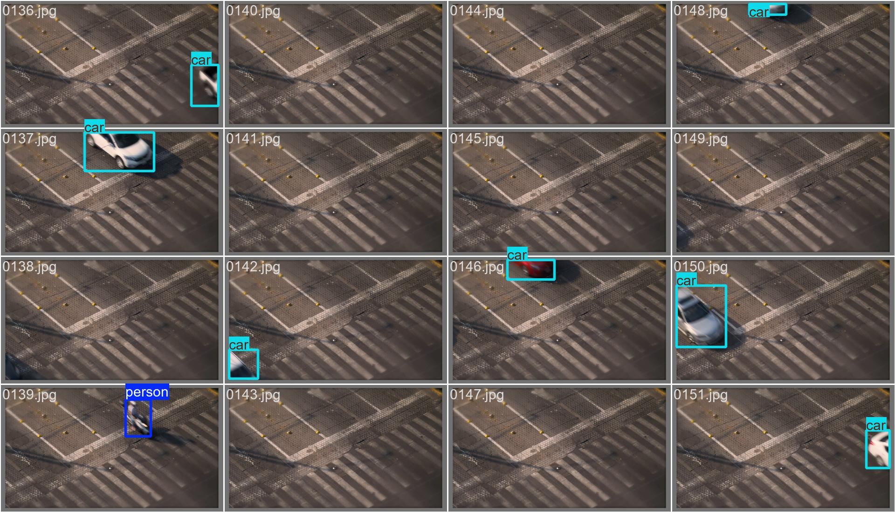
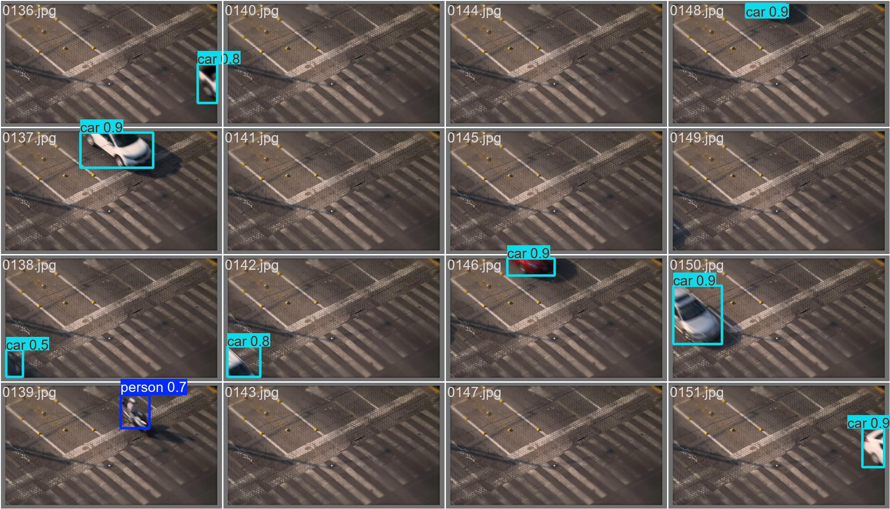

# YOLOv5 目标检测作业

## 1. 视频来源

Mixkit 免费素材《Aerial view of people at pedestrian crossing》，
固定机位俯拍路口，1280×720，24 fps，时长 42.6 秒。
授权：Mixkit License（免费使用，无需署名）。
项目内文件名：`source/intersection.mp4`。

## 2. 类别与标注数量

| 类别 | train | val | 合计 |
|------|-------|-----|------|
| person | 55 | 15 | 70 |
| car    | 170 | 37 | 207 |
| **合计** | **225** | **52** | **277** |

共 171 帧有效图片（136 训练 / 35 验证），其中无目标的背景帧保留为空标签一并参与训练。

## 3. 数据划分

按**时间顺序**划分，不随机打散：

- 4 fps 从 42.6 秒的素材中抽出 171 帧
- 前 136 帧（80%）→ 训练集
- 后 35 帧（20%）→ 验证集

相邻帧不跨集合分配，验证集与训练集在时间上完全隔离，
不存在"同一场景的重复帧"导致的指标虚高。

## 4. 训练配置

| 项目 | 设置 |
|---|---|
| 基础模型 | yolov5s.pt（COCO 预训练，迁移学习） |
| 输入尺寸 | 640×640 |
| batch | 16 |
| epochs | 100 |
| 优化器 | SGD（默认超参 hyp.scratch-low） |
| 硬件 | NVIDIA RTX 5060 Laptop 8GB |
| 环境 | Python 3.11 + PyTorch 2.9.1+cu128 + CUDA 12.8 |

复现命令：

```bash
python train.py --img 640 --batch 16 --epochs 100 \
  --data datasets/data.yaml --weights yolov5s.pt --device 0
```

## 5. 验证集指标

最终模型在 35 张验证图（52 个实例）上的表现：

| 类别 | Images | Instances | Precision | Recall | mAP@0.5 | mAP@0.5:0.95 |
|---|---|---|---|---|---|---|
| **all** | 35 | 52 | **0.869** | **0.919** | **0.931** | **0.666** |
| person | 35 | 15 | 0.904 | 1.000 | 0.995 | 0.773 |
| car | 35 | 37 | 0.833 | 0.838 | 0.868 | 0.559 |

训练日志：`runs/train/exp_final/`（results.csv 末行即上表数据）

## 6. 训练过程与评估图表

**训练曲线**（100 轮，box/obj/cls 损失持续下降，mAP 稳步上升并收敛）：



**混淆矩阵**（列 = 预测，行 = 真值；对角线为正确分类）：



**PR 曲线与 F1 曲线**：





**验证集标注 vs 模型预测对比**（同 16 张图，左为标注，右为预测）：

| 标注 | 预测 |
|---|---|
|  |  |

**val.py 独立评估输出**（与训练末轮指标一致，复现验证）：
见 [`charts/val_output.txt`](charts/val_output.txt)，
关键行：

```
val: Scanning ...\datasets\labels\val.cache... 35 images, 12 backgrounds, 0 corrupt
                 Class     Images  Instances          P          R      mAP50   mAP50-95
                   all         35         52      0.869      0.919      0.931      0.665
                person         35         15      0.904          1      0.995      0.774
                   car         35         37      0.833      0.838      0.867      0.556
```

## 7. 遇到的问题与处理

1. **素材是延时摄影，运动车辆有明显拖影**
   模糊帧里框难以贴合，标注时以"能辨认车身轮廓"为准，拖影过度的帧按空标签处理。

2. **大量空帧**
   171 帧中有 46 帧无任何目标（空路口），保留为背景样本，避免模型把路面纹理误判成目标。

3. **预标注存在误检**
   先用 COCO 预训练模型生成初稿（277 个框），再逐帧人工修正：
   删除把路面砖缝、路桩误判为 car 的框，补标漏检的人和车。

4. **远程/高分屏环境下标注工具崩溃**
   Qt 系标注工具在本机（双显卡 + 虚拟显示器）放大窗口即崩溃，
   改用 tkinter 自写的标注脚本完成标注。

## 8. 目录说明

```
result.mp4          检测结果视频（20 秒）
frame_01.png        从结果视频截取的画面
frame_02.png
frame_03.png
best.pt             训练产出的权重
README.md           本文件
data.yaml           数据集配置（复现用）
charts/             训练曲线、混淆矩阵、PR/F1 曲线、验证对比图、val.py 输出
```

数据集本身（图片与标签）体积较大且不含结果价值，按作业要求未上传，
划分方式与类别统计见上文第 2、3 节，可按说明重新整理。
